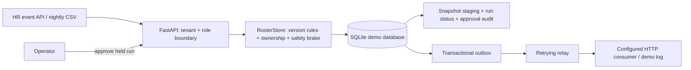
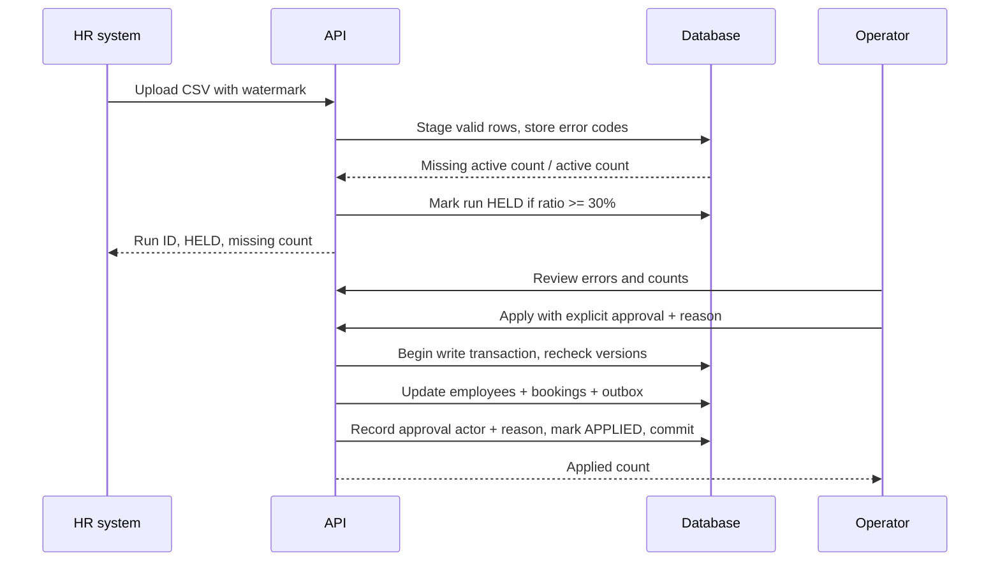

# Design note

## Architecture

The demo has one FastAPI process and one durable SQLite database. All business transitions are atomic within the database. The guided web screen uses the same API as an external caller and creates only synthetic records. A production deployment would replace SQLite with PostgreSQL and the HTTP relay with a broker publisher while retaining the same version and safety rules. The API layer handles authentication, tenant scoping, upload bounds, and safe responses; the core can run without a web server.

## Source ordering and reconciliation

The source system supplies a monotonic version for each employee event and a watermark for each export. An event only applies when its version is greater than the stored version. Equal version and equal canonical HR-state hash means duplicate, even if the envelope says `CREATE`, `UPDATE`, or `UPSERT`; equal version with changed content means conflict. Deactivation via a missing export only applies to records older than the export watermark. This ensures a delayed nightly file cannot erase a newer live update. The exporter contract must guarantee that the snapshot represents all employees at its watermark.

The HTTP upload spools to disk after 1 MiB and is read row by row into `snapshot_rows`, with invalid rows isolated in `sync_errors`. A SQL anti-join counts active employees absent from the file. At or above the configured missing threshold, the run is held. The operator sees the count and must explicitly approve **with a reason** before any changes are applied. On application, the service rechecks versions inside a write transaction, applies valid rows, deactivates eligible missing employees, inserts outbox records, records the approval actor and reason, advances the tenant watermark, and marks the run applied. Individual row conflicts are reported and skipped without aborting the batch.

## Hardest flow: truncated nightly file

## Failure behavior

| Failure | User sees | Recovery |
|---|---|---|
| Duplicate or delayed event | `DUPLICATE` or `STALE` | No state change; source may replay safely |
| Invalid row in file | Row error code | Other valid rows remain staged |
| Same-version conflicting row at apply time | Per-row `VERSION_CONFLICT` | Other rows apply; conflict needs source correction |
| Truncated export | `HELD`, missing count | Operator checks file and explicitly approves or replaces it |
| Crash before employee transaction commit | Request fails | Database rollback; safe replay |
| Crash after commit before publish | Update visible, event pending | Relay retries from outbox |
| Consumer receives event twice | Same event ID | Consumer deduplicates by ID |
| Relay endpoint down | Pending count grows | Retry on next relay loop; alert in production |
| Concurrent versions arrive out of order | Highest version wins | Serialized writes and version guard |

## Cost and scaling

Event application is O(1) indexed lookups and writes per employee, excluding downstream work. CSV ingestion is O(n) time with O(1) application memory plus the bounded HTTP spool and database staging table. The missing-row anti-join is indexed by `(run_id, employee_id)` and `(tenant_id, employee_id)`; the full comparison still touches up to O(n + m) rows. Disk usage is O(n) for staged rows and O(number of changes) for pending outbox records. The office-code cache is capped at 4,096 positive tenant-scoped keys with a 5-second TTL. The long SQLite write transaction is the first scaling limit; switch to PostgreSQL and a controlled chunk/activation design for multi-instance operation. Outbox backlog and slow consumers are the second limit.

## Consistency trade-offs

The event write path chooses consistency over write availability during database outage. The relay is asynchronous, so downstream systems see changes after a short delay and must tolerate duplicate delivery. The safety brake favors avoiding mass accidental deactivation over immediate agreement with a suspicious export. The demo uses a single database and simple token verifier to make the core rules inspectable; production identity, broker, and distributed rollout remain separate concerns.
